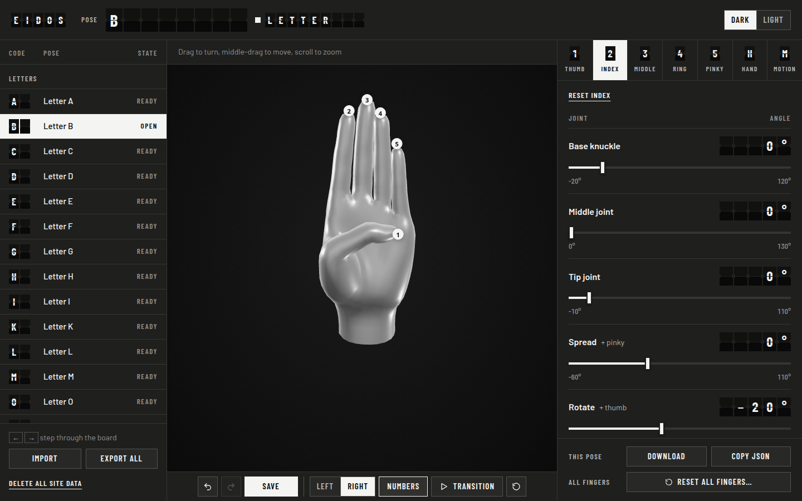

# Eidos

Eidos is a studio for posing a 3D hand finger by finger and saving each pose
as a reusable handshape.

It is a side project of [Sema](https://github.com/lanixiligan/sema), a sign
language learning app: Eidos is where Sema's handshapes are made, and Sema is
where they are used. You can use Eidos on its own for any hand poses.



## Features

- **A departure-board editor:** the pose name, whether it's saved, the finger
  numbers and every angle sit in split-flap cells that flip into place when
  they change.
- **Pose editor:** name the pose in the top bar, pick a finger (Thumb …
  Pinky, or Hand for the hand rotation) and set its joints. Angles are shown
  in degrees; signed angles name their positive direction (`+ pinky`). Click
  a number on the hand to jump to that finger.
- **The letter board:** letters and saved poses as board rows (code, pose,
  state); the open one is highlighted, and ← and → step through them.
- **Hand rotation:** turn, tilt and twist the whole hand, stored in the pose,
  for poses that point sideways or down.
- **A slider per joint**, with its range shown underneath. Click an angle
  to type it exactly, past the slider's ends too (poses have no limits), or
  step it with the up and down keys (5°, Shift for 1°). These keys are
  listed under the joints.
- **Undo / redo** in the top bar (Ctrl+Z, Ctrl+Shift+Z), reset for the shown
  finger under the finger tabs, and double-click a joint name to set it to
  0°. **Reset all fingers…** sits apart, at the foot of the editor, and asks
  before it straightens all five. Choosing a sign turns the view back to its
  starting angle.
- **Pose files:** **Save** in the top bar (Ctrl+S) keeps the pose in the
  browser; **Download** or **Copy JSON** under the editor; **Import** (or
  drop or paste JSON anywhere) and **Export all**, a zip ready for
  `letters/`, at the foot of the board. The strip over the hand reports each
  result and marks anything that didn't work.
- **Private by choice:** **Delete all site data**, at the foot of the board,
  removes your saved poses and settings from the browser.
- **Transition preview:** from **Transition** on the toolbar under the hand,
  play one pose into another over a set duration (100–2000 ms), the way they
  can be shown in a row.
- **Left and right hands:** poses are written once, for a right hand; the left
  hand mirrors them.
- **Sculpted hand:** gray, in dark mode and light mode alike. Drag to spin,
  middle-drag to move, scroll to zoom.
- **Narrow screens and touch:** below 860px the hand stays pinned at the top
  while the library and editor scroll beneath it; on touch screens the
  controls grow to finger-sized targets.

## Run locally

The editor is a React app built with Vite. You need Node 22.12 or newer:

```sh
npm install
npm run dev
```

Then open <http://localhost:5173>.

| Script | |
| --- | --- |
| `npm run dev` | Dev server with hot reload |
| `npm run build` | Build the static site into `dist/` |
| `npm run preview` | Serve the build from `dist/` |
| `npm run lint` | ESLint |
| `npm run check:letters` | Check every file in `letters/` is a valid pose listed in `index.json` |
| `npm run check` | Lint, the letter check and a build: what CI runs |

## Making poses

1. Pick a letter or saved pose as a starting point, or start from the hand
   at rest.
2. Shape each finger in the pose editor on the right.
3. Name the pose (for a letter, use the letter: `A`) and **Save** it in the
   browser (Ctrl+S), or **Download** it as `.json`.

Saved poses live in your browser's local storage. To put them in the repo,
use **Export all** (a zip) and unzip it into `letters/`. See
[letters/README.md](letters/README.md).

## Pose format

```json
{
  "version": 1,
  "pinky": [1.31, 1.7, 0.25],
  "ring": [1.37, 1.7, 0.2],
  "middle": [1.41, 1.7, 0.18],
  "index": [1.39, 1.7, 0.67],
  "thumb": [0.79, 0.69],
  "spread": { "index": -0.15, "middle": -0.03, "ring": -0.1, "pinky": 0.13, "thumb": -0.22 },
  "rotate": { "thumb": 0, "index": 0, "middle": 0, "ring": 0, "pinky": 0 },
  "wrist": { "turn": 0, "tilt": 0, "twist": 0 }
}
```

Angles are in radians. `wrist` rotates the whole hand, for poses that point
sideways or down (`"turn": 3.142` points the fingers down). The full description is in
[docs/POSE_FORMAT.md](docs/POSE_FORMAT.md), and
[docs/pose.schema.json](docs/pose.schema.json) is the JSON Schema.

## Using the hand in your own app

`src/hand.js` is the viewer on its own, without the editor UI; this is how
[Sema](https://github.com/lanixiligan/sema) shows its handshapes. Copy `src/hand.js` and `src/pose.js` into one
folder and `models/` next to that folder (or pass `modelUrl`), with `three`
installed or mapped, then:

```js
import { createHand } from './hand.js';

const hand = createHand(document.getElementById('hand'), {
  mode: 'light',        // 'dark' or 'light' backdrop (the hand is gray in both)
  side: 'right',        // or 'left' (mirrored)
  numbers: false,       // fingertip number badges
  background: false,    // transparent canvas over your own page
});

const pose = await (await fetch('/letters/A.json')).json();
hand.setPose(pose);     // eases into the pose
```

The container needs a size (for example `width: 400px; height: 400px`).

| Option | Default | |
| --- | --- | --- |
| `mode` | `'dark'` | `'dark'` or `'light'` backdrop; the hand is gray in both |
| `side` | `'right'` | `'right'` or `'left'` |
| `numbers` | `true` | Show fingertip number badges |
| `background` | `true` | `false` for a transparent canvas |
| `controls` | `true` | Drag to spin, middle-drag to move, scroll to zoom |
| `pose` | relaxed | Starting pose |
| `modelUrl` | `../models/hand-right.glb`, relative to `hand.js` | Sculpted hand glTF |
| `onTipClick` | `null` | `(finger) => {}` when a badge is clicked (see `setTipsClickable`) |

| Method | |
| --- | --- |
| `setPose(pose, { duration, instant })` | Ease to a pose; `duration` (ms) makes it a timed ease-in-out move, `instant: true` jumps. Throws on invalid data. |
| `getPose()` | The pose the hand is moving to |
| `setMode(mode)` / `getMode()` | Dark or light backdrop |
| `setSide(side)` / `getSide()` | Right or left hand |
| `setNumbersVisible(on)` | Show or hide fingertip numbers |
| `highlightFinger(finger, on)` | Accent one fingertip badge |
| `setTipsClickable(on)` | Let badges take clicks |
| `resetView()` | Ease back to the starting angle and zoom |
| `ready` | Promise: `true` once the sculpted model loads, `false` if it fails |
| `dispose()` | Stop rendering and free GPU resources |

`pose.js` also exports `normalizePose` (validate a pose), `serializePose`
(write one as JSON), `RELAXED_POSE` (the hand at rest) and `FINGER_NUMBERS`.

## Project layout

| Path | |
| --- | --- |
| `index.html` | The page shell Vite builds from |
| `src/main.jsx`, `src/App.jsx` | Entry point, and the state the editor's panels share |
| `src/components/` | The editor's panels (React) |
| `src/hooks/` | The pose being edited with undo, and the 3D hand kept in sync |
| `src/lib/` | Joint controls, pose library, pose files, settings |
| `src/style.css` | Styles and colour tokens |
| `src/hand.js` | The 3D hand: scene, model, controls, posing (no React) |
| `src/pose.js` | Pose format: validation, serialization, the resting pose |
| `src/zip.js` | Tiny zip writer for **Export all** |
| `scripts/check-letters.js` | The letter check CI runs |
| `letters/` | Letter poses and their `index.json` |
| `models/` | Sculpted hand glTF and its license |
| `docs/` | Pose format, its JSON Schema and the screenshot |

## Deploying

The [Check and deploy](.github/workflows/deploy.yml) workflow runs the lint,
the letter check and a build on every pull request and push. On `main` it
also publishes the build to GitHub Pages. To turn that on once, go to
**Settings → Pages** in the repository and set **Source** to **GitHub
Actions**.

## Credits and license

The code is MIT licensed; see [LICENSE](LICENSE).

The sculpted hand is the `generic-hand` model from
[WebXR Input Profiles](https://github.com/immersive-web/webxr-input-profiles),
MIT licensed, © 2019 Amazon. See
[models/LICENSE-webxr-hand-model.md](models/LICENSE-webxr-hand-model.md).
Rendering by [three.js](https://threejs.org) and the editor UI by
[React](https://react.dev), both MIT licensed.
